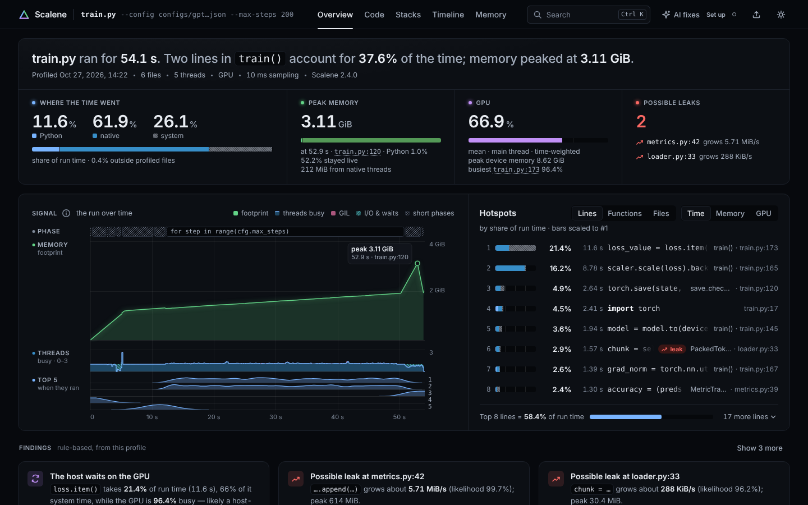
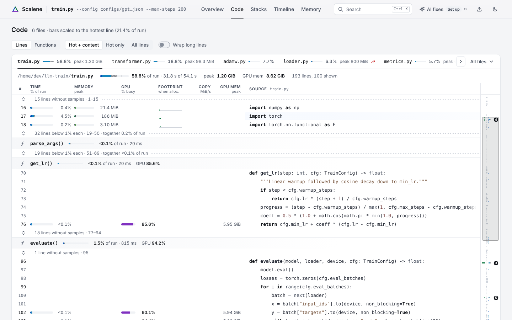
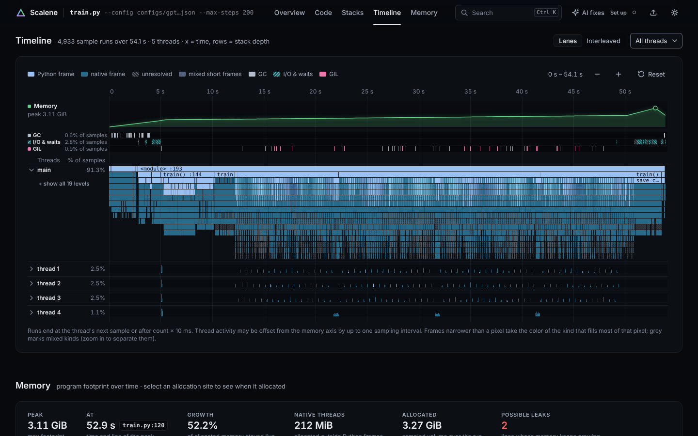
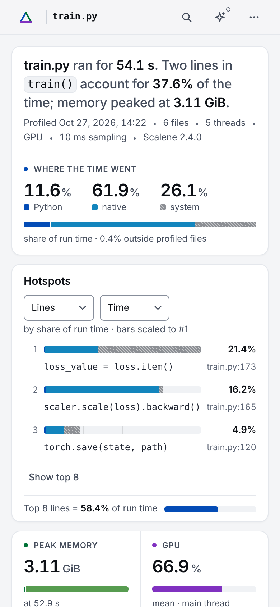

# Scalene UI

A redesigned report UI for [Scalene](https://github.com/plasma-umass/scalene), the Python
CPU/GPU/memory profiler. It is a drop-in replacement for Scalene's `scalene/scalene-gui/` front
end: same Jinja template variables, same JSON profile, same bundle file name, and it still works
offline from `file://`, in Jupyter's 400 px iframe and in the VS Code webview.



## What changed

The old report was a stack of collapsed per-file tables with tiny Vega charts. The new one
answers "where did my time and memory go, and what should I fix?" on the first screen:

- **Headline sentence** generated from the profile ("train.py ran for 54.1 s. Two lines in
  `train()` account for 37.6% of the time; memory peaked at 3.11 GiB.").
- **Readouts**: where the time went (Python / native / system), peak memory with time and line,
  GPU, possible leaks. Every number states its unit and what it is a share of.
- **Signal scope**: the run over time (memory footprint, threads busy, when the top lines ran)
  with an intro sweep that draws the real data, hover read-out and brushing.
- **Hotspots** ranked across all files by time, memory or GPU, and **findings** (rule-based, e.g.
  "the host waits on the GPU", possible leaks).
- **Code view**: virtualized source with per-line meters for every metric Scalene records, cold
  code folded, sortable columns, a heat-ribbon minimap and an inline detail lens.
- **Call stacks**: icicle flame graph for CPU and memory stacks with zoom, search and colour modes.
- **Timeline**: one lane per thread plus GC, I/O and GIL lanes, with brushing and zoom.
- **Memory**: footprint over time, allocation sites and leak candidates.
- **AI optimization proposals** for lines and regions with six providers (OpenAI, Anthropic,
  Gemini, Azure OpenAI, Amazon Bedrock, Ollama), called directly with `fetch`; no SDKs.
- Light and dark themes, reduced-motion support, keyboard navigation, command palette (`Ctrl K`),
  phone layout.

| Code view | Timeline | Phone |
|---|---|---|
|  |  |  |

The bundle has no runtime dependencies (no Vega, Bootstrap, jQuery or Prism): 940 KiB unminified,
250 KiB gzipped, against 1,426 KiB / 445 KiB of page assets in the current Scalene GUI.

## Use it with Scalene

On this branch the new UI is already installed: `scalene/scalene-gui/scalene-gui-bundle.js` and
`scalene/scalene-gui/index.html.template` are this project's build output, so `scalene
your_program.py` and `scalene --html --outfile report.html your_program.py` show it.

After changing anything under `scalene-ui/`, rebuild and reinstall with either of:

```sh
npm --prefix scalene/scalene-gui run build      # same as the two lines below
node scalene-ui/build.mjs && cp scalene-ui/dist/scalene-gui-bundle.js scalene-ui/template/index.html.template scalene/scalene-gui/
```

`scalene_utility.generate_html()` (standalone and linked) and `launchbrowser.generate_html()` render
the template unchanged; the window globals, the VS Code `jumpToLine` message, the `/heartbeat`
call and the strings checked by `tests/test_combined_stacks_gui.py` are preserved (DESIGN.md §7).
That test now reads the TypeScript entry from `scalene-ui/src/scalene-gui.ts`. The previous GUI's
sources in `scalene/scalene-gui/*.ts` are no longer used for the bundle; `npm run legacy:build`
still builds them.

## Build and test

Requirements: Node 18+ and a TypeScript compiler (`tsc` on `PATH` or in `node_modules`). Browser
checks use Playwright with Chromium.

```sh
node build.mjs                 # type-check, bundle to dist/, contract and size checks
node tools/unit.mjs            # unit tests (tests/unit)
node tools/render-fixture.mjs  # render every fixture into out/*.html (standalone + linked)
node tools/check.mjs           # Chromium matrix: fixtures x themes x widths
node tools/e2e.mjs             # browser acceptance suites
node tools/check-tokens.mjs    # design tokens and contrast
```

Run these from `scalene-ui/`. Open `out/ml-training.html` in a browser to see the richest example.
Set `SCALENE_SRC` to a Scalene checkout to enable the upstream `generate_html` parity test
(on this branch: `SCALENE_SRC=.. node tools/unit.mjs`).

Fixtures live in `fixtures/`. The three largest (`ml-training`, `async-server`, `huge`) are not
committed; regenerate them deterministically with `python3 tools/gen_fixtures.py --only
ml-training,async-server,huge`.

## Layout

```
src/
  main.ts, scalene-gui.ts   entry point and the upstream-compatible window globals
  core/                     DOM helpers, store, bus, theme, motion, virtual list, tooltips, host bridge
  model/                    profile normalization, rankings, headline, findings, stacks, timeline
  charts/                   axes, meters, sparklines, footprint chart
  views/                    overview, code, stacks, timeline, memory, AI, shell
  ai/                       AI providers, prompts and settings (DOM-free)
  styles/                   CSS, inlined into the bundle at build time
template/                   Jinja template used by Scalene
tools/, tests/              build helpers, fixture generator, unit and browser tests
DESIGN.md                   the design spec
design/QA.md                verification record, parity checklist, performance, known limitations
design/reference/           the approved prototype
```
